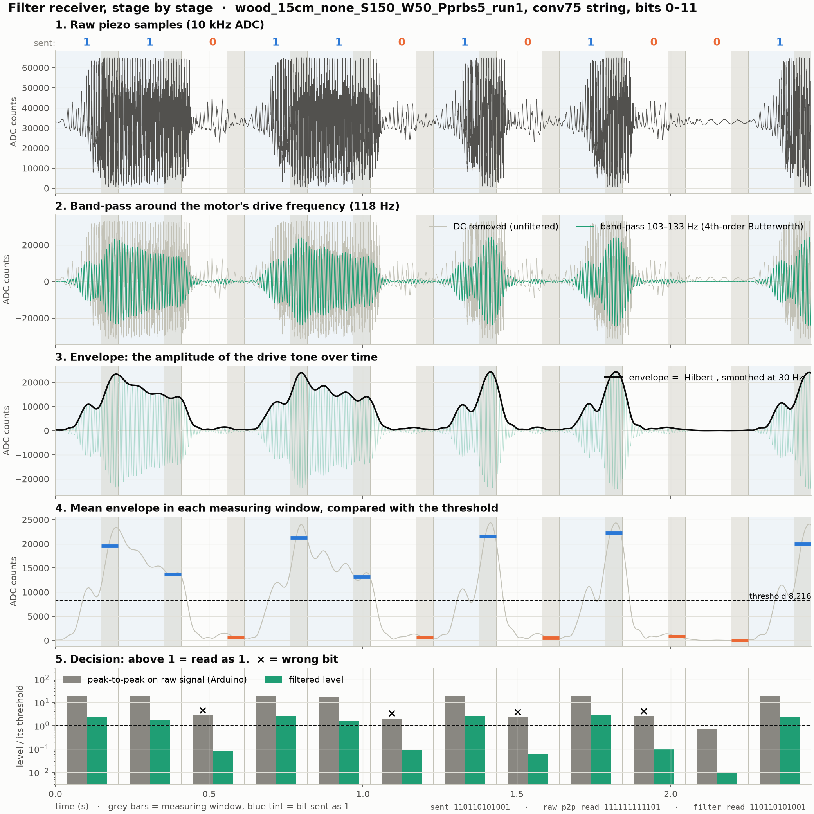

# Filter extension: implementation and how it plugs into the codes

## 1. How the filter is implemented

**Where the code is:** `codes/filtering.py`, function `filter_and_detect`. It runs in Python on the raw piezo samples (10 kHz) that the Giga streams back for every bit.

| Step | What it does | Implementation |
|---|---|---|
| **0. Pick the band** (once per material) | Find the motor's drive frequency | Spectrum of all of run 1 for that material; take the strongest peak ± 15 Hz. Saved in `experiments/filter_bands.json` (wood 103–133 Hz, acrylic 96–126 Hz, PCB 108–138 Hz) |
| **1. Remove DC** | Take away the ADC's mid-scale offset | Subtract the mean |
| **2. Band-pass** | Keep only the drive tone; drop the 40–60 Hz coast-down, 50 Hz mains and harmonics | 4th-order Butterworth, run forwards and backwards (`sosfiltfilt`) so it adds no delay |
| **3. Envelope** | Get how strong the drive tone is over time | Magnitude of the Hilbert transform, then a 30 Hz low-pass to smooth it |
| **4. One level per bit** | Measure each bit where the motor has settled | Mean envelope from 150 ms into the bit to the end of the bit (about 55 ms) |
| **5. Threshold** | Decide 0 or 1 | Midpoint between the quiet and loud bits of that string (a simple 2-group split, repeated until it settles). Level ≥ threshold → 1 |

What changes compared with the Arduino:

| | Arduino | Filter |
|---|---|---|
| What it measures | Peak-to-peak of *everything* in the window | Only energy at the frequency the motor makes while driven |
| Threshold | Fixed at start-up (noise + 3,000) | Set per string from that string's own levels |



The figure above shows steps 1–5 on real data (wood, 15 cm, run 1, convolutional string). Regenerate it with `python3 -m experiments.plot_demodulation`.

## 2. How it plugs into the error-correcting codes

The filter replaces **only the bit decision**. Encoding, sending and decoding are unchanged:

```
message ──encode──▶ coded bits ──▶ motor ──▶ specimen ──▶ piezo ──▶ raw samples
(31 bits)  (none/R3/R5/                                                │
            Hamming/conv)                        ┌─────────────────────┴─────────────────────┐
                                                 ▼                                           ▼
                                    Arduino: peak-to-peak + threshold          Filter: band-pass → envelope → threshold
                                                 │                                           │
                                                 ▼                                           ▼
                                           channel bits                                channel bits
                                                 │                                           │
                                                 └──────────▶  same decoder  ◀───────────────┘
                                                              (CODES[code].decode)
                                                                     │
                                                                     ▼
                                                     decoded message vs. sent message → errors
```

How it works in the code:

1. **Saving the raw samples.** `experiments/run_case.py` sends each coded string. The Giga returns its own peak-to-peak decision and the raw samples for every bit, and each string is saved as an `.npz` file containing the samples, where each bit starts, and the bits sent.
2. **Filtering.** `experiments/extensions.py` loads that file and runs `filter_and_detect`, which gives a new set of channel bits for the string.
3. **Decoding.** Those bits go into **the same decoder** as the Arduino's: `CODES[code].decode(bits)`. That's the Viterbi decoder for the convolutional code, majority vote for repetition, and so on.
4. **Scoring and saving.** The decoded message is compared with the original message, and the result is written to `<case>_filter.csv`, with the same columns as the Arduino's results. That's why the two can sit side by side in the tables.

**When it runs:**
- **Offline (`--replay`):** on every saved run. The results tables came from this, so it needed no extra hardware time.
- **Live (`--extension filter`):** after each string arrives, with its errors printed under the Arduino's.

**Why it was built this way:**
- **Nothing else changes.** The codes, the firmware and the way bits are sent are untouched. Any receiver can be swapped in, which is how the network extension (`--extension cnn`) was added later.
- **It's a fair comparison.** Both receivers decode the **exact same recorded strings**, so any difference comes from the receiver alone.
- **Every code gets both receivers for free.** That gives the 2×5 grid (receiver × code), which is how we showed the codes were failing because of intersymbol interference and not because they're weak.

**In one line:** the filter replaces the receiver's bit decision. Everything downstream (the codes and their decoders) is unchanged, so each code is tested with both receivers on identical recordings.
