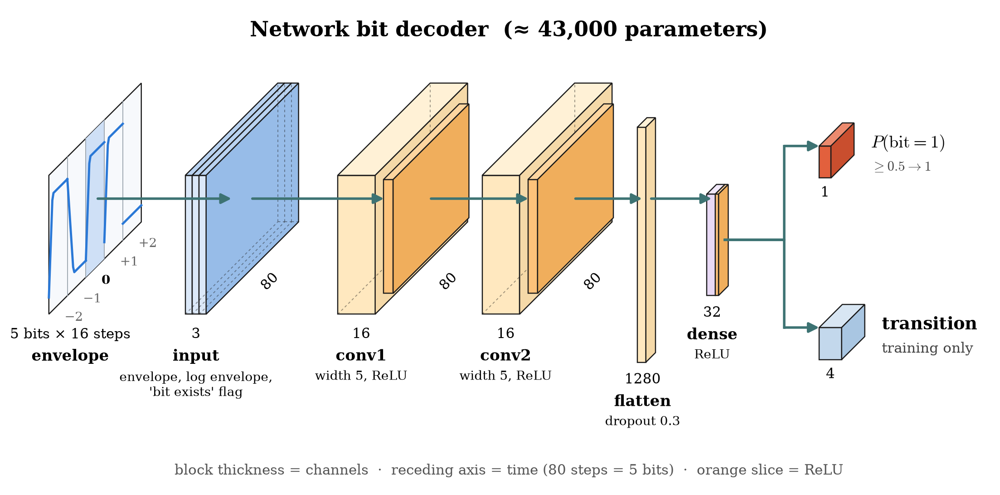
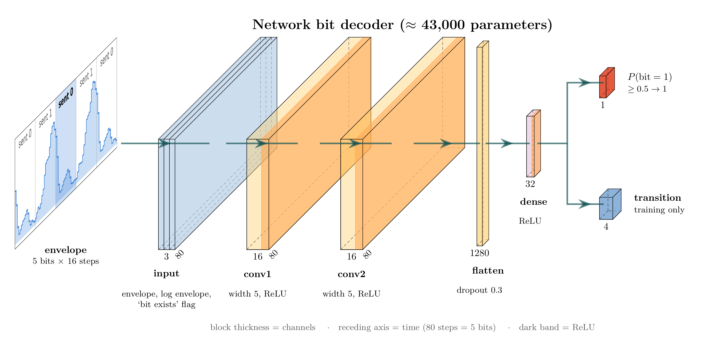

# Network extension: implementation and how it plugs into the codes

**Where the code is:** `codes/cnn_decoder.py` (model, training, features). It runs as the `cnn` extension in `experiments/extensions.py`, on the raw piezo samples (10 kHz) saved for every string.

## 1. How the network demodulates

```
raw samples → envelope → 16 steps per bit → this bit + 2 bits either side → CNN → P(bit = 1) → ≥ 0.5 → bit
```

| Step | What it does | Implementation |
|---|---|---|
| **1. Envelope** | How strong the vibration is over time | Subtract the median, rectify (\|x\|), then a 30 Hz low-pass (2nd-order Butterworth, zero-delay). **No band-pass**, so every frequency counts |
| **2. Cut into bit slots** | One slot per bit, lined up with the motor | Each slot starts when the motor was actually switched (`bit_start + switch_offset`) and lasts a full bit (2,048 samples, 204.8 ms) |
| **3. Compress each slot** | Keep the shape, drop the detail | Average into **16 steps** of 12.8 ms each |
| **4. Scale per string** | Make it independent of how loud this run is | Divide by the string's 95th-percentile level, so a typical 1 ≈ 1 |
| **5. Add context** | Let it see what came before and after | For each bit, join its 16 steps with the **2 bits before and 2 after**: 80 steps. A second channel marks which steps are real (0 past the ends of the string) |
| **6. Log channel** | Keep small leftovers visible | Add log(level + 0.02), so a coasting 0 (≈ 0.05) stands out from silence (≈ 0) as clearly as a 1 does |
| **7. CNN** | Decide | Outputs the probability that the bit is a 1 |
| **8. Decision** | Bit out | **P ≥ 0.5 → 1** |

## 2. The model



Regenerate the figure with `python3 -m experiments.plot_network_diagram`.

A LaTeX/TikZ version in the PlotNeuralNet style, whose input sheet is the real envelope of 5 bits from wood 15 cm run 1 (centred on a 0 sent after a 1):



Source: `figures/network/latex/cnn_architecture.tex`. Rebuild (PDF and PNG) with `python3 -m experiments.plot_network_latex`, which needs `brew install tectonic`.

- **Input (3 × 80):** envelope, log envelope and the "bit exists" flag, over 5 bits × 16 steps.
- **Two convolution layers** (16 filters, width 5, ReLU): small pattern detectors that slide along the 80 steps and pick out shapes like "rising edge", "coasting tail" or "flat".
- **Dense layer** (flatten 1,280 → dropout 0.3 → 32, ReLU): combines those shapes across the 5 bits into one decision.
- **Two outputs:**
  - **P(bit = 1)**, which is used to decide.
  - **Transition** (0→0, 0→1, 1→0, 1→1), used **only in training**. It forces the network to learn the four level shapes, especially "a 0 that starts loud because the previous bit was 1".
- **Size:** 42,709 parameters.

## 3. Training

| | |
|---|---|
| **Data** | The sent bits are the labels. By default: wood and acrylic runs without disturbance, settle 150 ms. That's **78 strings, 5,862 bits** (including the 10 `electrical-noise/` acrylic strings, because of how those folders are named) |
| **Loss** | Bit error (binary cross-entropy) + 0.5 × transition error (cross-entropy) |
| **Optimiser** | Adam, learning rate 0.002, weight decay 1e-4, 60 epochs, batches of 128 |
| **Augmentation** | Each example's level is randomly scaled by ±20%, so it doesn't rely on one exact loudness |
| **Baseline** | A plain linear model (logistic regression) on the same 80 steps, to show what the CNN adds over "a weighted sum and a threshold" |
| **Saved models** | `models/cnn_decoder.pt` (CNN), `models/cnn_decoder_linear.pt` (baseline) |

The sent bits are only used in training. When decoding a string, the network sees just the raw samples.

## 4. How it differs from the filter

| | Filter | Network |
|---|---|---|
| Removes the leftover vibration by | **Frequency** (band-pass at the drive tone) | **Shape over time** (learns what a 0 after a 1 looks like) |
| Looks at | Only the bit's measuring window (~55 ms) | The whole bit, from motor switch-on, **plus 2 bits either side** |
| Envelope | Band-passed, Hilbert magnitude | Broadband, rectified |
| Threshold | Midpoint, recomputed per string | Learned; fixed cut-off P ≥ 0.5 |
| Needs | A band per material (from run 1) | Training data |

Because it sees the previous bit, it can learn and undo the intersymbol interference directly, much like a learned equaliser. It also reads 2 bits ahead, so like the filter it only works once the whole string has arrived.

## 5. How it plugs into the error-correcting codes

Exactly like the filter. It replaces **only the bit decision**:

```
coded string → motor → piezo → raw samples ─┬→ Arduino (peak-to-peak)  ─┐
                                            ├→ filter                   ├→ same decoder (CODES[code].decode) → message → errors
                                            └→ network (P ≥ 0.5)        ─┘
```

1. `experiments/extensions.py` (`cnn_bits`) loads each string's saved `.npz` file and runs the model, which gives channel bits.
2. Those bits go to **the same decoder** as the other two receivers: Viterbi, majority vote or Hamming.
3. Results go in `<case>_cnn.csv`, with the same columns as the filter's. The level column holds P × 1000 with a threshold of 500, and strings the network was trained on are marked `in CNN training set`.

Run it with:

```
python3 -m experiments.run_case --replay --extension cnn
python3 -m experiments.run_case --replay --extension cnn --cnn-model models/other.pt   # a different model
```

## 6. Results (channel errors)

| Case | Arduino | Filter | Network |
|---|---|---|---|
| Wood / acrylic, no disturbance | 13.5–14.6% | 0–1.2% | 0% (trained on these runs) |
| PCB (never seen in training) | 15.3% | 0% | **0%** |
| Burst noise | 15.5% | 23.8% | **4.6%**, after which R3, R5 and conv decode everything |
| Constant noise | 13.6% | **6.6%** | 11.3%: reads 132 of 162 zeros after a 1 as 1s |

- **Why it handles bursts better:** it looks at the whole bit's shape and its neighbours, not one window against a threshold that a few loud bits can drag. Most of its remaining burst errors (48 of 55) are a knock during a 0 that looks like the motor running.
- **Why it fails under constant noise (likely cause):** it only ever saw quiet runs, and its envelope isn't band-passed. A steady noise floor raises every level, so a coasting 0 no longer looks like any 0 it was trained on. Training on noisy runs too, or band-passing before the envelope, would be the next things to try.

**Caveat:** the wood and acrylic results without disturbance are on the network's own training data, so they aren't a fair test. PCB and the disturbance runs were never seen in training.

**In one line:** instead of a hand-designed filter and threshold, the network learns from recorded signals what each bit looks like next to its neighbours. Like the filter, it removes the interference, and it copes far better with bursts, but because it only saw quiet training data it breaks under constant noise.
